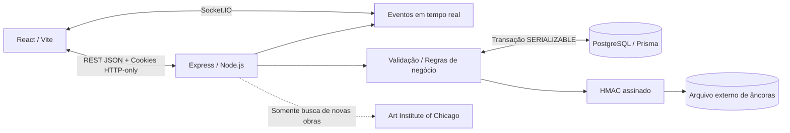
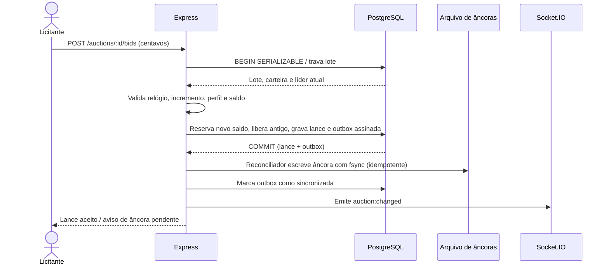

# Arquitetura e decisões

- Aplicação **same-origin**: API Express publica o build Vite e Socket.IO, com cookies HTTP-only; em desenvolvimento o Vite faz proxy.
- PostgreSQL é fonte de verdade. Moeda sempre em **centavos inteiros BigInt**.
- Transações `SERIALIZABLE` e bloqueio da linha do lote (`FOR UPDATE`) preservam a ordem de lances e os recursos da carteira sob concorrência. Conflitos de serialização são repetidos limitadamente.
- O intervalo de atividade é [startsAt, endsAt); lance recebido após `endsAt` é rejeitado, independentemente do estado salvo.
- Prorrogação: lance válido com tempo restante **até 120 segundos** altera `endsAt` para `endsAt + 120 segundos`.
- Cada lance reserva exatamente o novo valor; a liderança anterior é liberada. No encerramento, o vencedor é debitado uma única vez, o dono é creditado e o comprovante é gerado atomicamente.
- Histórico ordenado com sequência monotônica, hash encadeado com **HMAC-SHA-256** (chave somente no servidor); arquivo de âncoras fora do PostgreSQL para denunciar exclusões inclusive do último lance.
- Cada transação que aceita lance grava `AuditAnchorOutbox` com a assinatura e seu selo HMAC, usando chave `(auctionId, sequence)`. Um reconciliador serializa a escrita externa e registra `syncedAt` após `fsync`. Crash entre escrita e confirmação é recuperado sem duplicar a âncora.
- A verificação compara linhas do PostgreSQL, assinaturas e âncoras de arquivo. Sem âncora, nunca responde como íntegro: retorna `INDETERMINADO`.
- Serviço externo Art Institute of Chicago: busca e leitura pontual, timeout + cache; **snapshot** de arte na criação evita dependência da API nos fluxos críticos.
- Socket.IO publica eventos leves (IDs); o cliente consulta novamente o estado autoritativo, evitando confiar em mensagens de outros navegadores. O scheduler notifica cada lote ao iniciar, e o cliente reinscreve seus rooms após reconectar.

## Limites conhecidos

A âncora em arquivo deve ficar em **volume persistente separado do banco** e ser protegida por permissões/backup. Administrador com acesso ao *banco e ao arquivo e ao segredo do servidor* está fora do modelo de ameaça. Não é blockchain nem armazenamento WORM. Se a gravação da âncora falhar depois do commit do lance, a outbox permanece pendente para nova tentativa a cada 5 s; a auditoria continua `INDETERMINADO` até haver evidência externa. A fila só reenvia registros HMAC válidos que correspondam ao lance no banco. **A recuperação não é uma garantia de WORM:** falta de volume, escrita parcial ou alteração simultânea de banco/arquivo/segredo pode exigir intervenção. A outbox não reconstitui automaticamente âncoras já confirmadas e depois perdidas, porque isso esconderia exclusão do registro externo.

Depósitos são simulados, sem gateway, KYC, pagamentos reais ou tributação. Notas fiscais e revenda não fazem parte do desafio.

## Caminho da informação

## Fluxo do lance aceito

## Falhas esperadas

- Falha externa de catálogo: somente a **criação de novos lotes sem snapshot em cache** é afetada; as obras já persistidas continuam funcionais.
- Perda de Socket.IO: o socket reconecta automaticamente, reinscreve o room e recarrega o estado do PostgreSQL.
- Falha de âncora após commit: o lance é confirmado (para evitar duplicação), mas a outbox será processada novamente pelo scheduler. A auditoria fica inconclusiva e o encerramento **não** liquida até existir âncora válida.
- Conflito SERIALIZABLE: operação é repetida até quatro vezes; após esgotar tentativas, retorna conflito.
- Serviço reiniciado: scheduler volta a analisar lotes cujo prazo passou; a liquidação é idempotente.
